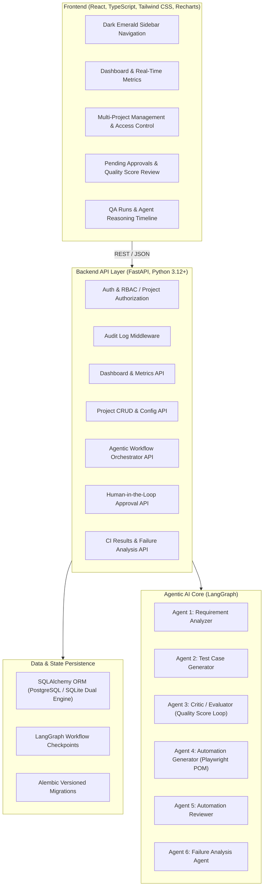

# Enterprise Agentic QA Operations Platform — Architecture & Phase 1 Plan

## 1. System Architecture Overview

The **Enterprise Agentic QA Operations Platform** is a multi-tenant, role-aware engineering system designed to automate end-to-end QA workflows: from requirement intake, test scenario extraction, Playwright Python automation script synthesis, critic-in-the-loop self-refinement, human-in-the-loop approvals, to GitHub pull requests and CI execution failure root-cause analysis.



---

## 2. Directory Structure

```
Enterprise Agentic QA Operations Platform/
├── backend/
│   ├── app/
│   │   ├── __init__.py
│   │   ├── main.py                  # FastAPI application entry point, CORS, routers, static mount
│   │   ├── config.py                # Environment configuration (Pydantic Settings)
│   │   ├── database.py              # SQLAlchemy engine, session maker, base class, auto-migration
│   │   ├── seed_data.py             # Realistic enterprise demonstration data seeder
│   │   ├── models/                  # SQLAlchemy ORM models
│   │   │   ├── __init__.py
│   │   │   ├── user.py              # User & Role models (Admin, QA Manager, QA Engineer, Viewer)
│   │   │   ├── project.py           # Projects, memberships, repository configs
│   │   │   ├── requirement.py       # Requirements, user stories, acceptance criteria
│   │   │   ├── test_case.py         # Test cases, steps, priority, versions
│   │   │   ├── automation_script.py # Playwright scripts, page objects, fixtures
│   │   │   ├── workflow.py          # Agent runs, checkpoint records, agent logs
│   │   │   ├── approval.py          # Approval requests, reviewer decisions, comments
│   │   │   ├── execution.py         # CI executions, test outcomes, failure analyses
│   │   │   └── audit.py             # Security and action audit logs
│   │   ├── schemas/                 # Pydantic v2 validation & response schemas
│   │   │   ├── __init__.py
│   │   │   ├── user.py
│   │   │   ├── project.py
│   │   │   ├── requirement.py
│   │   │   ├── test_case.py
│   │   │   ├── workflow.py
│   │   │   ├── approval.py
│   │   │   ├── execution.py
│   │   │   └── dashboard.py
│   │   ├── core/                    # Core infrastructure: security, permissions, audit
│   │   │   ├── __init__.py
│   │   │   ├── security.py          # JWT validation & password hashing utilities
│   │   │   ├── permissions.py       # RBAC & project-level authorization checks
│   │   │   └── audit_logger.py      # Structured audit logging service
│   │   ├── services/                # Business logic services
│   │   │   ├── __init__.py
│   │   │   ├── project_service.py   # Project lifecycle, access filtering, config
│   │   │   ├── dashboard_service.py # Aggregate metrics, trends, coverage calculations
│   │   │   └── seed_service.py      # Deterministic demo seeder
│   │   ├── api/                     # REST API routing
│   │   │   ├── __init__.py
│   │   │   ├── router.py            # Central v1 API router
│   │   │   ├── deps.py              # FastAPI dependency injection (DB, Current User)
│   │   │   └── endpoints/
│   │   │       ├── auth.py          # Token & current user endpoints
│   │   │       ├── projects.py      # Project CRUD & membership endpoints
│   │   │       ├── dashboard.py     # Metrics, trends, recent runs, agent activity
│   │   │       ├── requirements.py  # Requirements intake & listing
│   │   │       ├── workflows.py     # QA workflow trigger & state inspection
│   │   │       ├── approvals.py     # Approval queue & decision recording
│   │   │       ├── executions.py    # Test runs & failure analysis views
│   │   │       └── audit.py         # Audit log querying
│   │   └── static/                  # Embedded responsive enterprise SPA (ready-to-run)
│   │       ├── index.html           # Full React SPA with Tailwind CSS, Recharts, Lucide
│   │       └── app.js               # Reactive stateful frontend dashboard
│   └── tests/                       # Backend test suite (pytest)
│       ├── __init__.py
│       ├── conftest.py              # Test database fixtures & client
│       ├── test_health.py           # API health check test
│       ├── test_projects.py         # Project CRUD and permissions tests
│       └── test_dashboard.py        # Dashboard metrics and aggregation tests
├── frontend/                        # Standalone React + TypeScript + Vite project
│   ├── package.json
│   ├── tsconfig.json
│   ├── vite.config.ts
│   ├── tailwind.config.js
│   ├── postcss.config.js
│   ├── index.html
│   └── src/
│       ├── App.tsx
│       ├── main.tsx
│       ├── types/
│       ├── components/
│       │   ├── layout/Sidebar.tsx
│       │   ├── layout/Header.tsx
│       │   ├── dashboard/MetricCards.tsx
│       │   ├── dashboard/RecentRunsTable.tsx
│       │   ├── dashboard/AgentTimeline.tsx
│       │   ├── dashboard/TrendCharts.tsx
│       │   └── projects/ProjectModal.tsx
│       └── services/api.ts
├── alembic/                         # Alembic migration environment
│   ├── env.py
│   ├── script.py.mako
│   └── versions/
│       └── 001_initial_schema.py
├── alembic.ini
├── docker-compose.yml
├── Dockerfile.backend
├── Dockerfile.frontend
├── .env.example
└── README.md
```

---

## 3. Visual Design System

- **Sidebar**: Dark Emerald Green (`#062d24`, `#04201a`), with emerald glow accents (`#10b981`), refined iconography (Lucide), and badge indicators.
- **Backgrounds**: Light neutral background (`#f8fafc`, `#f1f5f9`) for clean contrast and zero eye fatigue.
- **Cards & Surfaces**: Clean white cards (`#ffffff`) with border strokes (`#e2e8f0`), soft shadows (`0 1px 3px 0 rgb(0 0 0 / 0.07)`), and rounded corners (`rounded-xl`).
- **Typography**: Crisp modern sans-serif typography with hierarchy: bold headers, slate muted labels (`#64748b`), and monospaced code badges (`#0f172a`).
- **Data Visualizations**: Recharts Area & Donut charts in emerald (`#10b981`), cobalt (`#3b82f6`), amber (`#f59e0b`), and rose (`#f43f5e`).
- **Demo Mode**: Explicit header indicator badge ("DEMO MODE: ACTIVE") and mode switch.

---

## 4. Phase 1 Implementation Scope

1. **Backend Foundation**:
   - Pydantic Settings configuration (`config.py`).
   - Database connection management supporting SQLite (instant zero-setup) and PostgreSQL (`database.py`).
   - 16 SQLAlchemy models covering the entire platform lifecycle.
   - Database seed script with rich realistic enterprise demonstration data.
   - Pydantic request and response schemas.
   - REST API routers: Auth, Projects, Dashboard, Workflows, Approvals, Executions, Audit.
2. **Multi-Project Management**:
   - Create, Read, Update, Archive project endpoints.
   - Automation framework configuration (Playwright Python, POM, browser matrix).
   - Role-based authorization & project memberships.
3. **Interactive Dashboard**:
   - Summary metric cards with delta percentages.
   - Recent QA runs table with execution status badges.
   - Real-time agent activity timeline.
   - Trend charts (executions over time, pass/fail distribution, requirement coverage).
   - Pending approval notifications.
   - "New QA Run" modal dialog with project selection and workflow configuration.
4. **Testing & Verification**:
   - Pytest unit and integration test suite.
   - Health, project CRUD, and dashboard metric tests.
5. **Setup & Deployment Artifacts**:
   - `.env.example`, `docker-compose.yml`, `alembic.ini`, and Windows execution instructions in `README.md`.
