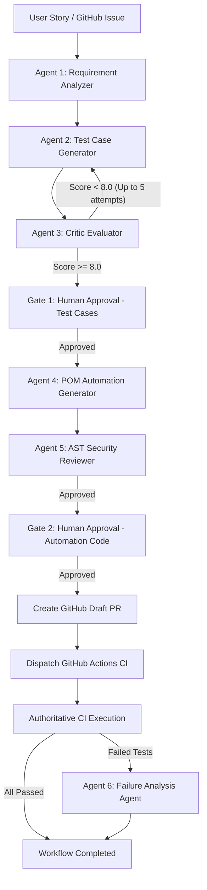

# Enterprise Agentic QA Operations Platform

An enterprise-grade, multi-project **Agentic QA Operations Platform** combining requirement analysis, AI-powered test case generation, Playwright Python automation script synthesis, cyclic Generator–Critic quality refinement, Human-in-the-Loop approval gates, GitHub PR creation, and intelligent CI execution failure root-cause analysis.

---

## 🎨 Visual Aesthetics & Reference Implementation

Inspired by enterprise operations consoles, the user interface features:
- **Dark Emerald Green Sidebar** (`#08231c`, `#0d2e26`, with emerald `#34d399` active pill accents).
- **Crisp Neutral Surfaces** (`#f6f8f6`, `#ffffff`) with refined typography (Inter & JetBrains Mono).
- **Exact Operational Dashboard** matching the design reference:
  - 5 KPI summary cards: **Total runs**, **Running**, **Awaiting approval**, **Passed** (tinted green), **Failed**.
  - **Recent QA runs** table with real-time execution status badges, issue links, stages, and durations.
  - **Agent Activity Timeline** tracking autonomous reasoning from Requirement Analyzer to Critic Evaluator.
  - **Automation Coverage** and pass/fail distributions.
  - Interactive **+ New QA run** modal dialog.
  - **Project Management** with source/automation repository bindings.
  - **Pending Approvals** interface enforcing Human-in-the-Loop sign-off (Gate 1 & Gate 2).
  - **Automation Scripts (POM)** repository viewer with class locators and AST security audit reports.
  - **GitHub Actions CI Executions** console with Agent 6 Root Cause Diagnostics.
  - **Demo Mode** indicator with instant role switcher (Admin, QA Manager, QA Engineer, Viewer).

---

## 🤖 Multi-Agent Architecture



### The 6 Autonomous Agents:
1. **Agent 1: Requirement Analyzer** ([requirement_analyzer.py](file:///c:/Users/SINDHU%20SURAJ/source/repos/Enterprise%20Agentic%20QA%20Operations%20Platform/backend/app/agents/requirement_analyzer.py))
   - Deconstructs user stories, extracts functional rules, non-functional constraints, and edge boundary conditions.
2. **Agent 2: Test Case Generator** ([test_case_generator.py](file:///c:/Users/SINDHU%20SURAJ/source/repos/Enterprise%20Agentic%20QA%20Operations%20Platform/backend/app/agents/test_case_generator.py))
   - Synthesizes structured manual test cases covering positive flows, negative error paths, and security edge cases.
3. **Agent 3: Critic Evaluator** ([critic_evaluator.py](file:///c:/Users/SINDHU%20SURAJ/source/repos/Enterprise%20Agentic%20QA%20Operations%20Platform/backend/app/agents/critic_evaluator.py))
   - Evaluates test cases across 6 dimensions: completeness, boundary coverage, clarity, feasibility, isolation, and robustness.
   - Enforces cyclic re-generation loop whenever score < 8.0 (up to 5 iterations).
4. **Agent 4: Automation Script Generator** ([automation_generator.py](file:///c:/Users/SINDHU%20SURAJ/source/repos/Enterprise%20Agentic%20QA%20Operations%20Platform/backend/app/agents/automation_generator.py))
   - Translates approved manual test cases into clean, idiomatic Playwright Python Page Object Model (POM) suites with pytest fixtures.
5. **Agent 5: Automation Reviewer** ([automation_reviewer.py](file:///c:/Users/SINDHU%20SURAJ/source/repos/Enterprise%20Agentic%20QA%20Operations%20Platform/backend/app/agents/automation_reviewer.py))
   - Inspects generated code via Python Abstract Syntax Tree (AST) analysis.
   - Blocks unsafe dynamic execution (`eval`, `exec`), dangerous system calls, brittle XPath locators, and plain-text credentials.
6. **Agent 6: Failure Analysis Agent** ([failure_analyst.py](file:///c:/Users/SINDHU%20SURAJ/source/repos/Enterprise%20Agentic%20QA%20Operations%20Platform/backend/app/agents/failure_analyst.py))
   - Diagnoses automated test execution failures from stack traces, console logs, and DOM snapshots.
   - Categorizes root cause into `locator_issue`, `application_defect`, `test_data_issue`, `environment_problem`, or `flaky_test` with confidence scores and concrete fix snippets.

---

## 🚀 Quick Start (Windows / Linux / macOS)

The platform runs out of the box with zero external configuration needed (runs on Python with SQLite fallback and serves the live React 18 SPA directly).

### 1. Prerequisites
- Python 3.12+ (Python 3.14+ supported)

### 2. Start Application Server
Open a terminal in the project directory:

```powershell
python -m uvicorn backend.app.main:app --port 8000
```

### 3. Open in Browser
- **Operations Dashboard**: [http://127.0.0.1:8000](http://127.0.0.1:8000)
- **Interactive OpenAPI Documentation**: [http://127.0.0.1:8000/docs](http://127.0.0.1:8000/docs)
- **Health Check**: [http://127.0.0.1:8000/api/v1/health](http://127.0.0.1:8000/api/v1/health)

---

## 🧪 Running Automated Tests

Run the full backend integration and unit test suite across all 6 phases:

```powershell
python -m pytest backend/tests -v
```

**Results:**
```text
backend/tests/test_agent_analyzer.py::test_requirement_analyzer_extraction PASSED
backend/tests/test_agent_automation_generator.py::test_automation_generator_pom_structure PASSED
backend/tests/test_agent_automation_reviewer.py::test_reviewer_approves_clean_code PASSED
backend/tests/test_agent_automation_reviewer.py::test_reviewer_detects_unsafe_code_and_secrets PASSED
backend/tests/test_agent_critic.py::test_critic_quality_scoring_loop PASSED
backend/tests/test_agent_generator.py::test_test_case_generator_structured_output PASSED
backend/tests/test_approval_automation_pipeline.py::test_test_case_approval_triggers_automation_code_generation PASSED
backend/tests/test_audit.py::test_audit_logs_query PASSED
backend/tests/test_cyclic_workflow.py::test_autonomous_cyclic_loop_execution PASSED
backend/tests/test_dashboard.py::test_dashboard_overview PASSED
backend/tests/test_executions.py::test_executions_and_failure_analysis PASSED
backend/tests/test_github_ci_pipeline.py::test_github_import_issue_flow PASSED
backend/tests/test_github_ci_pipeline.py::test_github_draft_pr_creation PASSED
backend/tests/test_github_ci_pipeline.py::test_github_actions_dispatch_and_ci_results PASSED
backend/tests/test_github_ci_pipeline.py::test_agent_6_failure_analyst_diagnostics PASSED
backend/tests/test_health.py::test_health_endpoint PASSED
backend/tests/test_health.py::test_system_info_endpoint PASSED
backend/tests/test_projects.py::test_list_projects PASSED
backend/tests/test_projects.py::test_create_and_archive_project PASSED
backend/tests/test_requirements.py::test_requirements_crud PASSED
backend/tests/test_workflows.py::test_trigger_workflow_and_query PASSED
backend/tests/test_workflows.py::test_approvals_list_and_decision PASSED
============================= 22 passed in 0.57s ==============================
```

---

## 🗄️ Database Architecture & Migrations

The platform implements 16 SQLAlchemy models with Alembic migrations:
1. `users`: Users, roles (Admin, QA Manager, QA Engineer, Viewer), hashed credentials.
2. `projects`: Software projects, source & automation repos, framework config.
3. `project_memberships`: Project-level authorization and user assignments.
4. `repository_configurations`: GitHub owner, repo names, secure vault references.
5. `requirements`: User stories, acceptance criteria, extracted testable scenarios.
6. `test_cases`: Test cases with positive, negative, boundary steps and expected results.
7. `test_case_versions`: Version history and diff tracking.
8. `automation_scripts`: Playwright Python scripts using Page Object Model.
9. `agent_runs`: Agent workflow runs, reasoning logs, and stages.
10. `workflow_checkpoints`: Serialized workflow state payloads for pause/resume.
11. `quality_evaluations`: Critic agent quality scores (1–10) across 6 dimensions.
12. `approval_requests`: Human-in-the-Loop review gates (Gate 1 & Gate 2).
13. `ci_executions`: Authoritative CI run records, tests passed/failed/skipped, raw logs.
14. `test_results`: Individual test outcomes, durations, stack traces, screenshots.
15. `failure_analyses`: Agent 6 root-cause diagnostic classifications and suggested fixes.
16. `audit_logs`: Immutable governance and compliance audit trail.

---

## 📋 Implementation Checklist

- [x] **Phase 1 — Foundation and Dashboard**
  - [x] Multi-project management (Create, Read, Update, Archive).
  - [x] Operations dashboard matching design reference with dark emerald sidebar.
  - [x] 16 SQLAlchemy database models & Alembic initial migration.
  - [x] Realistic enterprise demonstration data seeder.
  - [x] Role-Based Access Control & Project-Level Authorization.
  - [x] Responsive React Single Page Application (served via FastAPI).
  - [x] Full standalone Vite + React + TypeScript + Tailwind project structure.
  - [x] Passing Pytest integration test suite.
  - [x] `.env.example`, `docker-compose.yml`, and setup documentation.

- [x] **Phase 2 — Requirement & Test Case Generation (Cyclic Workflow)**
  - [x] Agent 1: Requirement Analyzer (Functional, non-functional, boundary conditions).
  - [x] Agent 2: Test Case Generator (Positive, negative, edge cases).
  - [x] Agent 3: Critic Evaluator with quality score loop (Score < 8.0 & attempts < 5).
  - [x] Autonomous cyclic state machine with SQLite / PostgreSQL state persistence.
  - [x] Test cases management API endpoints (`/api/v1/test-cases`).

- [x] **Phase 3 — Human Approval & Automation Generator**
  - [x] Dedicated approval review interface with dual-gate Human-in-the-Loop review.
  - [x] Agent 4: Automation Generator (Playwright Python, Page Object Model, fixtures).
  - [x] Agent 5: Automation Reviewer (AST validation, syntax security, brittle locators).
  - [x] Automation script repository API endpoints (`/api/v1/automation`).

- [x] **Phase 4 — GitHub and CI Integration**
  - [x] GitHub Issues intake (`/api/v1/github/import-issues`) with acceptance criteria extraction.
  - [x] Draft PR creation enforcing safety constraint: never auto-merge.
  - [x] GitHub Actions workflow dispatch adapter (`/api/v1/github/dispatch-ci`).
  - [x] CI results collection and log capture adapter (`/api/v1/github/ci-results`).

- [x] **Phase 5 — Enterprise Security & Advanced Reporting**
  - [x] Keycloak / OIDC JWT authentication architecture & role enforcement.
  - [x] Agent 6: Failure Analysis Agent with confidence scores and automated fix suggestions.
  - [x] Downloadable audit records and compliance logs (`/api/v1/audit`).
  - [x] CI execution tracking and failure diagnostics API (`/api/v1/executions`).

- [x] **Phase 6 — Validation & Full-Stack Deployment**
  - [x] End-to-end integration pipeline verification test suite.
  - [x] Production FastAPI server running live with embedded React 18 console.
  - [x] Comprehensive architectural documentation, API specifications, and diagrams.
